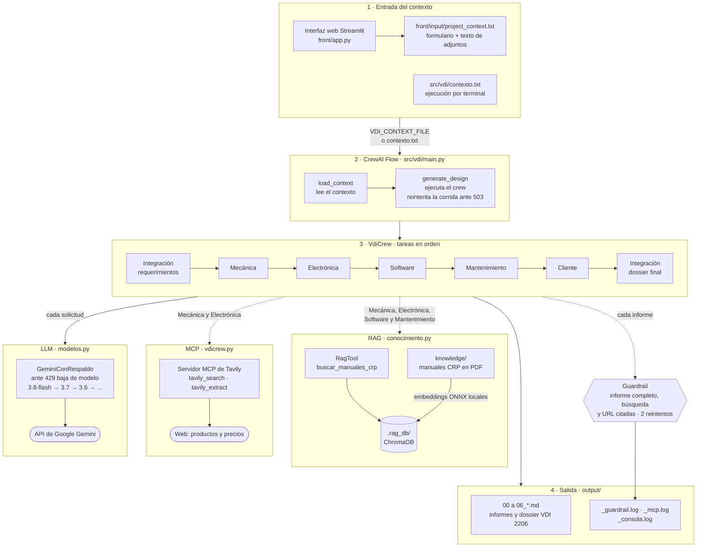

# VDI 2206 — Sistema Multiagente para el Diseño Conceptual Mecatrónico

**Informe técnico del proyecto final** · SI7016 Procesamiento de Lenguaje Natural Aplicado · EAFIT 2026-2

**Autores:** Andres Arteaga · Franco Garces
**Repositorio:** [github.com/AAV-99/VDI](https://github.com/AAV-99/VDI) (rama `feature/interfaz-streamlit`)

Sistema multiagente basado en **CrewAI Flows** y **Google Gemini** que hace el trabajo de una junta de diseño: seis agentes, cada uno con el rol de una disciplina de ingeniería, revisan un proyecto mecatrónico y entregan el expediente conceptual completo según la norma **VDI 2206**. Los agentes consultan manuales técnicos con **RAG**, buscan componentes reales en la web por **MCP** y cada informe pasa por **guardrails** automáticos.

Este documento tiene dos partes: el **informe técnico** (problema, diseño, evaluación y trabajo futuro) y el **manual de instalación y uso**.

---

## Tabla de Contenidos

**Parte I · Informe técnico**

1. [Resumen](#1-resumen)
2. [Problema y motivación](#2-problema-y-motivación)
3. [Objetivos](#3-objetivos)
4. [Arquitectura del sistema](#4-arquitectura-del-sistema)
5. [Diseño de los componentes](#5-diseño-de-los-componentes)
6. [Evaluación y resultados](#6-evaluación-y-resultados)
7. [Limitaciones](#7-limitaciones)
8. [Trabajo futuro](#8-trabajo-futuro)
9. [Referencias](#9-referencias)

**Parte II · Manual de instalación y uso**

10. [Requisitos previos](#10-requisitos-previos)
11. [Instalación paso a paso (Windows)](#11-instalación-paso-a-paso-windows)
12. [Configuración](#12-configuración)
13. [Interfaz web (Streamlit)](#13-interfaz-web-streamlit)
14. [Documentos de consulta del RAG](#14-documentos-de-consulta-del-rag)
15. [Búsqueda web por MCP (Tavily)](#15-búsqueda-web-por-mcp-tavily)
16. [Archivos de salida](#16-archivos-de-salida)
17. [Estructura del proyecto](#17-estructura-del-proyecto)

---

# Parte I · Informe técnico

## 1. Resumen

El diseño conceptual de un sistema mecatrónico exige coordinar mecánica, electrónica, software, mantenimiento y los requisitos del cliente, y documentar cada decisión según la norma VDI 2206. Este proyecto automatiza esa revisión con un sistema multiagente:

- **Entrada:** el usuario describe el sistema en un formulario web (tipo, alcance, requisitos, costo objetivo) y puede adjuntar documentos.
- **Proceso:** seis agentes especializados ejecutan siete tareas en orden, como en una junta de diseño real. Cada agente lee lo que decidieron los anteriores y el agente Cliente audita el resultado y emite solicitudes de cambio (ECR).
- **Salida:** seis informes por disciplina y un dossier consolidado VDI 2206 en Markdown, con diagramas Mermaid y listas de materiales (BOM) con productos reales y su URL.

Técnicas del curso que integra: **LLM** (Gemini, con una cadena de 9 modelos ante el límite de cuota), **RAG agentic** con embeddings locales sobre 6 manuales técnicos, **MCP** con el servidor de búsqueda web de Tavily y **guardrails** que validan cada informe.

## 2. Problema y motivación

Un sistema mecatrónico (un robot, un efector final, un nodo IoT, una máquina especial) combina mecánica, electrónica y software, y además debe ser mantenible y cumplir lo que pide el cliente. La norma **VDI 2206** ordena ese trabajo con el **modelo en V**: se baja de los requisitos del sistema al diseño de cada dominio y se sube integrando y validando.

En la práctica aparecen tres dificultades:

| Dificultad | Consecuencia |
|---|---|
| **Disciplinas en silos** | Cada área decide por separado y los conflictos entre subsistemas aparecen tarde. |
| **Conocimiento disperso** | Manuales, catálogos, normas y precios están en fuentes distintas. |
| **Documentación exigente** | Cada proyecto pide matriz de requisitos, arquitectura, BOM, análisis RAMS y validación. |

Un sistema multiagente encaja con el problema: cada agente asume una disciplina, se pasan el trabajo entre sí y las herramientas (RAG y búsqueda web) les dan acceso al conocimiento técnico disperso.

## 3. Objetivos

**Objetivo general:** construir un sistema multiagente que genere el expediente de diseño conceptual de un sistema mecatrónico según VDI 2206, a partir de una descripción en lenguaje natural.

**Objetivos específicos:**

1. Modelar una junta de diseño con agentes por disciplina que se comuniquen a través de sus informes.
2. Dar a los agentes acceso a conocimiento técnico con RAG sobre manuales y con búsqueda web por MCP.
3. Validar automáticamente cada informe (completitud, diagramas, uso de herramientas y citas de fuentes).
4. Ofrecer una interfaz web para describir el proyecto, ejecutar el flujo y consultar los resultados.
5. Que el sistema no dependa de un producto concreto: los mismos roles sirven para un gripper, un nodo IoT o una máquina especial.

## 4. Arquitectura del sistema



| Capa | Componente | Archivo |
|---|---|---|
| Entrada | Formulario web o archivo de contexto | `front/app.py`, `src/vdi/contexto.txt` |
| Orquestación | CrewAI Flow con reintentos ante saturación | `src/vdi/main.py` |
| Agentes | Crew secuencial de 6 agentes y 7 tareas | `src/vdi/crews/vdicrew/` |
| Conocimiento | RAG sobre manuales (RagTool + ChromaDB) | `conocimiento.py`, `knowledge/` |
| Búsqueda web | Servidor MCP remoto de Tavily | `vdicrew.py` |
| Modelo | Gemini con cadena de modelos de respaldo | `modelos.py` |
| Validación | Guardrail por tarea con registro | `vdicrew.py` |
| Salida | Informes Markdown con diagramas Mermaid | `output/` |

## 5. Diseño de los componentes

### 5.1 Agentes y tareas

Seis agentes definidos en `config/agents.yaml` (rol, objetivo y trasfondo) ejecutan siete tareas de `config/tasks.yaml`:

| # | Agente | Tarea | Herramientas | Informe |
|---|---|---|---|---|
| 1 | Integración (team lead) | Matriz de requerimientos y arquitectura VDI 2206 | — | `01_requirements_and_system.md` |
| 2 | Mecánica | Subsistema mecánico y BOM | RAG + MCP | `02_mechanical_subsystem.md` |
| 3 | Electrónica | Hardware de control/potencia y BOM | RAG + MCP | `03_electronic_subsystem.md` |
| 4 | Software | Arquitectura de software/firmware, sin código | RAG | `04_software_architecture.md` |
| 5 | Mantenimiento | Evaluación RAMS y diagnóstico PHM | RAG | `05_rams_maintenance.md` |
| 6 | Cliente | Auditoría de requisitos y costo, solicitudes de cambio (ECR) | — | `06_client_acceptance.md` |
| 7 | Integración (team lead) | Dossier consolidado VDI 2206 | — | `00_vdi2206_consolidated_dossier.md` |

**Decisiones de diseño:**

- **Proceso secuencial (`Process.sequential`):** reproduce el orden del modelo en V (requisitos → dominios → validación → integración) y hace que cada agente reciba los informes anteriores. Así la electrónica parte del concepto mecánico y el Cliente audita el diseño completo.
- **Un agente Cliente crítico:** en lugar de que el sistema se apruebe a sí mismo, un agente con el rol de representante del usuario revisa costo y requisitos y emite ECR, como en una revisión de diseño real.
- **Herramientas solo donde aportan:** Integración y Cliente trabajan con los informes y no tienen herramientas. Cada herramienta adicional suma solicitudes al LLM, y la cuota es el recurso más escaso del proyecto.
- **Prompts con formato estricto:** cada tarea exige tablas, diagramas en Mermaid con una sintaxis segura (etiquetas siempre entre comillas) y una marca de fin `<!-- FIN DEL INFORME -->` que el guardrail verifica.

### 5.2 Orquestación

`src/vdi/main.py` define un **CrewAI Flow** con dos pasos: `load_context` lee el contexto (del archivo indicado en `VDI_CONTEXT_FILE`, de `src/vdi/contexto.txt` o de un payload JSON) y `generate_design` ejecuta el crew.

- Si Gemini responde que está saturado (`503`, `UNAVAILABLE`, `overloaded`) o corta la conexión, el Flow repite la corrida completa hasta 3 veces, con esperas de 60, 120 y 240 s.
- `Ctrl + C` termina todo el proceso de inmediato, incluidas las solicitudes en curso. El crew corre en otro hilo del Flow, y sin esto seguiría enviando solicitudes.

### 5.3 RAG agentic sobre manuales técnicos

Los agentes de Mecánica, Electrónica, Software y Mantenimiento tienen la herramienta `buscar_manuales_crp`, un `RagTool` de `crewai_tools` sobre 6 manuales del robot industrial CRP (operación, programación, armario eléctrico G4-CD60, PLC, soldadura y brazo RA09A-07).

| Etapa | Implementación |
|---|---|
| Extracción | RagTool lee los PDF de `knowledge/` con PyMuPDF |
| Troceo | `TextChunker` de crewai_tools: 1 500 caracteres con 150 de solape |
| Embeddings | `all-MiniLM-L6-v2` en ONNX, calculado en el propio equipo |
| Almacenamiento | ChromaDB persistente en `.rag_db/` |
| Consulta | Top 4 fragmentos con similitud ≥ 0,3 |

**Decisiones de diseño:**

- **RAG agentic:** el agente decide cuándo consultar, según la descripción de la herramienta. No se inyectan fragmentos en todos los prompts.
- **Embeddings locales:** no requieren API key ni consumen cuota de Gemini.
- **Reindexación solo si cambian los documentos:** se guarda una huella (nombre, tamaño y fecha) de cada archivo en `.rag_db/documentos_indexados.json`. Si coincide, se reutiliza el índice; si no, se reconstruye desde cero para no dejar fragmentos de documentos borrados.
- **Consultas en inglés:** los manuales están en inglés y el modelo de embeddings funciona mejor en ese idioma.
- **Umbral de 0,3 en lugar del 0,6 por defecto:** con 0,6 quedaban fuera fragmentos pertinentes.

### 5.4 Búsqueda web por MCP

Mecánica y Electrónica arman BOM con componentes comerciales, así que tienen conectado el **servidor MCP remoto de Tavily** con el soporte nativo de CrewAI (`Agent(mcps=[MCPServerHTTP(...)])`).

- **Herramientas habilitadas:** solo `tavily_search` y `tavily_extract`, con un filtro estático. Las demás (crawl, map, research) gastan más créditos.
- **Tope de 4 búsquedas por tarea:** al llegar al tope, la herramienta ya no consulta a Tavily y le responde al agente que redacte con lo que tiene. Evita que el modelo se quede buscando sin escribir el informe.
- **Registro:** cada conexión, búsqueda y URL devuelta queda en `output/_mcp.log` y en la consola con el prefijo `[MCP]`.
- **Seguridad:** la API key va en el encabezado `Authorization` y no en la URL, para que no quede en los registros.
- **Sin `TAVILY_API_KEY`**, los agentes corren igual, pero sin búsqueda web.

### 5.5 Modelo de lenguaje y cadena de respaldo

El plan gratuito de Gemini limita las solicitudes **por día y por modelo**. `modelos.py` define `GeminiConRespaldo`, una subclase del cliente Gemini de CrewAI que, ante un `429` por cuota diaria, repite la **misma solicitud** con el siguiente modelo de la cadena:

```text
gemini-3.8-flash → gemini-3.7-flash → gemini-3.6-flash → gemini-3.5-flash → gemini-3.5-flash-lite
→ gemini-3-flash-preview → gemini-3.1-flash-lite → gemini-2.5-flash → gemini-2.5-flash-lite
```

- **Por solicitud y no por corrida:** el crew sigue desde la tarea en que iba, sin repetir (ni volver a pagar) las anteriores.
- Los modelos agotados se saltan en todos los agentes durante el resto de la corrida, y cada corrida nueva vuelve a empezar por el mejor modelo.
- Si el `429` es por el límite **por minuto**, espera lo que indique Gemini y reintenta con el mismo modelo.
- El crew limita el ritmo a 4 solicitudes por minuto (`max_rpm=4`), por debajo del límite de 5 del plan gratuito.

### 5.6 Guardrails

Cada tarea tiene un guardrail programático (`guardrail_informe_completo` en `vdicrew.py`) que revisa:

| Comprobación | Aplica a |
|---|---|
| El informe termina con la marca `<!-- FIN DEL INFORME -->` (no quedó cortado) | Todas las tareas |
| No hay bloques de código ni diagramas Mermaid sin cerrar | Todas las tareas |
| El agente usó la búsqueda web al menos una vez | Mecánica y Electrónica |
| El BOM cita al menos una URL que devolvió la búsqueda | Mecánica y Electrónica |

Si una comprobación falla, el agente reescribe el informe con instrucciones concretas (por ejemplo, la lista de URL que devolvió su búsqueda), hasta 2 veces. Después se acepta tal cual para no perder la corrida. Cada revisión queda en `output/_guardrail.log` como `COMPLETO`, `REINTENTO` o `ACEPTADO_INCOMPLETO`.

### 5.7 Interfaz web

`front/app.py` es una interfaz en **Streamlit**:

- **Formulario** con tipo de sistema, alcance, requisitos, costo objetivo y contexto adicional, más documentos adjuntos (TXT, MD, CSV, PDF o DOCX) cuyo texto se agrega al contexto.
- **Dos modos:** *Simulación*, que muestra informes de ejemplo sin llamar a Gemini, y *Agentes reales*, que ejecuta el Flow completo.
- **Ejecución robusta:** la salida del Flow va a `output/_consola.log` y no a un pipe. Si la página se recarga a mitad de la corrida, los agentes siguen trabajando; la interfaz detecta la corrida en curso por su número de proceso y ofrece un botón para detenerla.
- **Resultados:** cada informe en una pestaña con botón de descarga. Los diagramas Mermaid se dibujan con `front/mermaid_render.py`, que corrige en Python los errores típicos del LLM, valida el diagrama antes de dibujarlo y, si aún falla, muestra el código como texto en lugar de un error.
- **Historial:** las corridas anteriores se archivan en `output/_anteriores/<fecha>/`, incluso si Windows u OneDrive tienen los archivos bloqueados.

## 6. Evaluación y resultados

### 6.1 Metodología

Cada corrida deja evidencia verificable en dos registros: `output/_guardrail.log` (resultado de cada informe) y `output/_mcp.log` (cada búsqueda con sus URL). Sobre ellos se mide:

| Criterio | Cómo se mide |
|---|---|
| Completitud | Marca de fin presente y diagramas cerrados (guardrail) |
| Uso real de herramientas | Búsquedas registradas por tarea (`_mcp.log`) |
| Citación de fuentes | URL de la búsqueda presentes en el BOM (guardrail) |
| Cumplimiento de requisitos y costo | Matriz de conformidad del agente Cliente (`06_client_acceptance.md`) |

Además, componentes aislados se probaron sin gastar cuota: la recuperación del RAG con consultas directas a la herramienta y el cambio de modelo ante `429` con respuestas simuladas.

### 6.2 Caso de estudio: gripper de vacío

Entrada (`front/input/project_context.txt`): gripper de ventosas para un robot de 6 ejes que mueve láminas de acero estampadas de hasta 8 kg, con 24 V DC, aire a 6 bar y un presupuesto de 4 500 USD. Resultado (`output/00_vdi2206_consolidated_dossier.md`):

| Requisito | Meta | Propuesta de los agentes | Dictamen |
|---|---|---|---|
| Masa del gripper | ≤ 6 kg | 3,22 kg | Conforme |
| Costo de materiales | ≤ 4 500 USD | 1 955 USD (56 % por debajo) | Conforme |
| Capacidad de carga | Láminas de 8 kg | Matriz de 8 ventosas de fuelle | Conforme |
| Corte de energía | La pieza no cae | Válvulas biestables de doble solenoide | Conforme |
| Pieza presente | Sensado | Vacuóstatos digitales SMC ZSE30AF | Conforme |

El BOM usa productos reales encontrados por la búsqueda web (ventosas Piab, eyectores SMC), con su URL. El agente Cliente emitió un dictamen **aprobado con observaciones** y dos solicitudes de cambio: tornillos imperdibles para el mantenimiento y un manómetro visual de respaldo.

### 6.3 Resultados de las corridas

En las 4 corridas completas de evaluación:

| Métrica | Resultado |
|---|---|
| Informes aprobados por el guardrail | 27 de 28 |
| Reintentos automáticos del guardrail | 4 |
| Búsquedas web por tarea | Máximo 4, cada una registrada con sus URL |
| Corridas archivadas para comparar versiones | 16 |

**Hallazgos:**

- En una corrida, los dos BOM no citaban las URL de la búsqueda; el guardrail lo detectó y ambos se corrigieron solos en el reintento.
- En otra, Electrónica no usó la búsqueda ni después de 2 reintentos; el sistema aceptó el informe y lo dejó marcado como `ACEPTADO_INCOMPLETO`.
- Algunas búsquedas devuelven 0 resultados. Sin el tope de 4, el agente podía quedarse buscando sin escribir el informe.

## 7. Limitaciones

- **Diseño conceptual, no detallado:** las masas, costos y componentes son propuestas de los agentes, no mediciones ni cotizaciones formales. Requieren revisión de un ingeniero.
- **La evaluación automática mide forma y uso de herramientas,** no la exactitud técnica de cada decisión. Falta validar los informes con ingenieros de planta.
- **Dependencia de la cuota gratuita de Gemini:** una corrida completa puede consumir buena parte de la cuota diaria de un modelo; la cadena de respaldo lo mitiga pero no lo elimina.
- **Corpus del RAG acotado:** solo contiene manuales del robot CRP, en inglés. Para otros equipos hay que cambiar los documentos de `knowledge/`.
- **Calidad de la búsqueda web:** depende de los resultados de Tavily; algunas consultas no devuelven productos útiles.
- **Ejemplo del nodo IoT pendiente:** el formulario está en `front/ejemplos/entrada/02_nodo_iot_formulario.txt`, pero `front/ejemplos/salida_nodo_iot/` hoy contiene los informes del gripper y debe regenerarse.

## 8. Trabajo futuro

**Inferencia local en Apolo.** En la rama `main` ya corre el crew completo en el clúster Apolo de EAFIT, con Ollama y un modelo abierto:

| | API de Gemini (hoy) | Apolo con Ollama |
|---|---|---|
| Modelo | Cadena de 9 modelos Gemini Flash | Qwen 3.8 de 27B, cuantizado q4_K_M (`qwen3.8-vdi`) |
| Contexto | Según el modelo | 131 072 tokens (fijado en el `Modelfile`) |
| Velocidad | Según la carga del servicio | ~57 tokens por segundo |
| Límite de uso | ~20 solicitudes por día y por modelo | Sin cuota ni costo por solicitud |
| Datos del proyecto | Salen a un servicio externo | Se quedan en EAFIT |

Próximos pasos:

1. Llevar el RAG, el MCP y la interfaz web al modelo local, y elegir el proveedor con una variable de entorno.
2. Afinar un modelo abierto con los dossiers aprobados y las ECR del agente Cliente.
3. Validar los informes con ingenieros de planta.
4. Agregar observabilidad de las corridas (trazas por agente, herramienta y token).

## 9. Referencias

1. VDI/VDE 2206 (2021). *Development of mechatronic and cyber-physical systems*. Verein Deutscher Ingenieure.
2. Lewis, P. et al. (2020). Retrieval-Augmented Generation for Knowledge-Intensive NLP Tasks. *NeurIPS 2020*.
3. Reimers, N. y Gurevych, I. (2019). Sentence-BERT: Sentence Embeddings using Siamese BERT-Networks. *EMNLP 2019*. (Base del modelo `all-MiniLM-L6-v2`.)
4. CrewAI. Documentación oficial: agentes, tareas, Flows, herramientas y MCP. https://docs.crewai.com
5. Model Context Protocol. Especificación. https://modelcontextprotocol.io
6. Tavily. Documentación del servidor MCP. https://docs.tavily.com
7. Google. Gemini API. https://ai.google.dev/gemini-api/docs
8. Chroma. Documentación de ChromaDB. https://docs.trychroma.com

---

# Parte II · Manual de instalación y uso

## 10. Requisitos previos

- Sistema operativo Windows
- Cuenta de Google (para la API key de Gemini)
- Cuenta de Tavily (opcional, para la búsqueda web de los agentes)
- Conexión a internet para descargar dependencias
- Python 3.12 (lo instala `uv` en el paso 3; no hace falta instalarlo por separado)

> ⚠️ **Cuota de Gemini:** el plan gratuito permite pocas solicitudes por día y por modelo (del orden de 20) y 5 por minuto. Una corrida completa hace al menos 7 solicitudes (una por tarea), más las de las herramientas y los reintentos. Cuando un modelo agota su cuota, la corrida sigue con el siguiente (ver [5.5](#55-modelo-de-lenguaje-y-cadena-de-respaldo)). Para probar la interfaz sin gastar cuota usa el modo **Simulación**.

## 11. Instalación paso a paso (Windows)

Esta secuencia configura el entorno desde cero en un Windows sin herramientas previas.

### 1. Instalar software base

- **Git for Windows:** necesario para clonar el proyecto. Descarga e instala desde la [guía oficial de Git](https://git-scm.com/download/win).
- **Visual Studio Code:** editor recomendado. Descarga e instala desde la [guía oficial de VS Code](https://code.visualstudio.com/docs/setup/windows).

### 2. Obtener las API keys

1. **Gemini:** en [Google AI Studio](https://aistudio.google.com/), inicia sesión y genera una clave en **Get API Key** (más detalles en la [documentación de Google AI Studio](https://ai.google.dev/gemini-api/docs/api-key)).
2. **Tavily (opcional):** crea una cuenta en [Tavily](https://app.tavily.com/) y copia tu API key. El plan gratuito incluye un cupo mensual de búsquedas.

### 3. Instalar `uv` y Python 3.12

**uv** administra las versiones de Python, el entorno virtual y las dependencias del proyecto. No hace falta instalar Python desde python.org ni Anaconda.

1. Abre **PowerShell**.
2. Ejecuta el comando de instalación oficial (ver la [guía de instalación de uv](https://docs.astral.sh/uv/getting-started/installation/)):

   ```powershell
   powershell -ExecutionPolicy ByPass -c "irm https://astral.sh/uv/install.ps1 | iex"
   ```

3. **Cierra y vuelve a abrir PowerShell** para que el comando `uv` quede registrado, y comprueba la instalación:

   ```powershell
   uv --version
   ```

4. Instala Python 3.12, la versión que usa el proyecto (fijada en el archivo `.python-version`):

   ```powershell
   uv python install 3.12
   ```

> El proyecto admite Python 3.10 a 3.13 (`pyproject.toml`). Si ya tienes otra instalación de Python, uv no la modifica: usa la 3.12 solo para este proyecto.

### 4. Clonar el repositorio y abrirlo en VS Code

1. En PowerShell, ve a la carpeta donde guardarás tus proyectos:

   ```powershell
   cd ~\Desktop
   ```

2. Clona el repositorio y cambia a la rama del proyecto:

   ```powershell
   git clone https://github.com/AAV-99/VDI.git
   cd VDI
   git checkout feature/interfaz-streamlit
   ```

3. En VS Code, abre la carpeta del proyecto desde **Archivo > Abrir carpeta...**

### 5. Instalar dependencias y crear el `.env`

1. Abre la terminal integrada de VS Code (`Ctrl + ~`).
2. Crea el entorno virtual e instala CrewAI y todas las librerías de `pyproject.toml`:

   ```powershell
   uv sync
   ```

   Esto crea la carpeta `.venv/` con Python 3.12. Los comandos `uv run ...` usan ese entorno aunque no esté activado.

3. En la raíz del proyecto (junto a `pyproject.toml`), crea un archivo `.env` con tus claves:

   ```env
   GEMINI_API_KEY="tu_api_key_de_gemini"
   TAVILY_API_KEY="tu_api_key_de_tavily"
   ```

### 6. Definir el contexto del proyecto

Si usas la [interfaz web](#13-interfaz-web-streamlit), la interfaz genera el contexto y puedes saltar este paso.

Para ejecutar por terminal, edita `src/vdi/contexto.txt` respetando sus secciones:

```text
## TIPO DE SISTEMA
Efector Final (Gripper) para Manipulación de Láminas de Acero

## ALCANCE DEL PROYECTO
Diseño mecatrónico e integración de un efector final (gripper) liviano (< 1.5 kg) ...

## REQUERIMIENTOS PRIMARIOS
- Masa total del gripper <= 1.5 kg ...
- Tiempo de ciclo pick-and-place <= 4.0 s.

## COSTO OBJETIVO
Costo objetivo de fabricación <= 1000 USD.
```

### 7. Ejecutar

Inicia el flujo de agentes desde la terminal:

```powershell
uvx crewai run
```

*(También funciona `uv run kickoff`).*

Los informes quedan en `output/` (ver [Archivos de salida](#16-archivos-de-salida)). Para detener la ejecución presiona **`Ctrl + C`**.

> La primera ejecución indexa los documentos de `knowledge/` (alrededor de 1 minuto). Las siguientes reutilizan el índice.

## 12. Configuración

### Variables del `.env`

| Variable | Obligatoria | Uso |
|---|---|---|
| `GEMINI_API_KEY` | Sí | API key de Google Gemini |
| `TAVILY_API_KEY` | No | Búsqueda web por MCP para Mecánica y Electrónica. Sin ella, los agentes corren sin búsqueda |
| `VDI_LLM_MODELS` | No | Cadena de modelos de Gemini, del mejor al peor, separados por comas (por defecto, la de `modelos.py`) |
| `VDI_CONTEXT_FILE` | No | Ruta de un `.txt` de contexto distinto de `src/vdi/contexto.txt`. La interfaz web la define sola |

Para usar otra cadena de modelos, usa solo nombres con versión (como `gemini-3.7-flash`): con nombres como `gemini-flash-latest`, CrewAI desactiva las herramientas y el razonamiento.

```env
VDI_LLM_MODELS="gemini-3.8-flash,gemini-3.7-flash,gemini-3.6-flash"
```

### Parámetros fijos

| Parámetro | Valor | Dónde |
|---|---|---|
| Temperatura | 0,2 | `vdicrew.py` |
| Tokens máximos por respuesta | 32 000 (incluye el razonamiento de Gemini; con menos, los informes se cortan) | `vdicrew.py` |
| Solicitudes por minuto | 4 (`max_rpm`) | `vdicrew.py` |
| Búsquedas web por tarea | 4 (`MAX_BUSQUEDAS_POR_TAREA`) | `vdicrew.py` |
| Reintentos del guardrail | 2 (`MAX_REINTENTOS_INCOMPLETO`) | `vdicrew.py` |
| Reintentos de la corrida ante 503 | 3, con esperas de 60, 120 y 240 s | `main.py` |
| Resultados del RAG | 4 fragmentos con similitud ≥ 0,3 | `conocimiento.py` |

### Otros comandos

```powershell
uv run plot                                                  # Abre en el navegador el diagrama del flujo (no llama a Gemini)
uv run run_with_trigger '{\"contexto\": \"## TIPO DE SISTEMA ...\"}'   # Ejecuta con el contexto como JSON
```

## 13. Interfaz web (Streamlit)

### Ejecutar la interfaz

Desde la raíz del proyecto (Streamlit, pypdf y python-docx se instalan solos desde `front/requirements.txt`):

```powershell
uv run --with-requirements front/requirements.txt streamlit run front/app.py
```

Se abre en el navegador en `http://localhost:8501`.

### Uso

1. **Modo de ejecución** (barra lateral):
   - **Simulación (mock):** no llama a Gemini. Devuelve los informes de ejemplo de `front/ejemplos/salida/`. Sirve para probar la interfaz sin gastar cuota.
   - **Agentes reales (CrewAI):** ejecuta el flujo completo. Requiere el `.env` en la raíz.
2. **Contexto del problema:** tipo de sistema y alcance (obligatorios), requerimientos, costo objetivo y contexto adicional.
3. **Documentos de soporte (opcional):** TXT, MD, CSV, PDF o DOCX. Su texto se agrega al contexto, así que lo leen **todos** los agentes.
4. **Generar input y ejecutar agentes:** genera `front/input/project_context.txt`, lanza el flujo y muestra el log en vivo.
5. **Resultados:** cada informe aparece en una pestaña, con sus diagramas Mermaid y un botón de descarga.

Si recargas la página durante una corrida, los agentes siguen trabajando. Al volver, la interfaz avisa que hay una corrida en curso y ofrece el botón **Detener la corrida en curso**. La consola completa queda en `output/_consola.log`.

| Modo | Informes en | Corridas anteriores |
|---|---|---|
| Simulación | `front/output/` | Se reemplazan |
| Agentes reales | `output/` | Se archivan en `output/_anteriores/<fecha>/` |

**Ejemplos para el formulario** (`front/ejemplos/entrada/`): `01_textos_formulario.txt` (gripper de vacío), `02_nodo_iot_formulario.txt` (nodo IoT de monitoreo de motores) y documentos de soporte en TXT, DOCX y PDF.

> **Documentos de soporte vs. documentos de consulta:** los adjuntos de la interfaz son de un proyecto concreto y se copian completos en el contexto de todos los agentes. Los de `knowledge/` son una base permanente que los agentes buscan por fragmentos con RAG. Para manuales extensos usa `knowledge/`.

## 14. Documentos de consulta del RAG

Para cambiar los documentos que consultan los agentes:

1. Agrega, reemplaza o borra archivos en `knowledge/`. Formatos admitidos: **PDF, DOCX, TXT y MD**.
2. Si cambia el tema, actualiza `DESCRIPCION` en `src/vdi/crews/vdicrew/conocimiento.py`: es el texto que lee el agente para decidir cuándo usar la herramienta.
3. Ejecuta el proyecto como siempre: se detecta el cambio y se reindexa todo.

Para forzar una reindexación, borra la carpeta `.rag_db/`. Para probar la búsqueda sin llamar a Gemini:

```powershell
uv run python -c "from vdi.crews.vdicrew.conocimiento import buscar; print(buscar('emergency stop wiring'))"
```

## 15. Búsqueda web por MCP (Tavily)

Con `TAVILY_API_KEY` en el `.env`, Mecánica y Electrónica buscan componentes reales en cada corrida (ver [5.4](#54-búsqueda-web-por-mcp)). Para revisar qué buscaron, abre `output/_mcp.log` o filtra la consola por `[MCP]`.

Para probar solo la conexión con el servidor, sin llamar a Gemini:

```powershell
uv run python test_mcp.py
```

El script se conecta a `https://mcp.tavily.com/mcp/`, lista las herramientas del servidor y hace una búsqueda de prueba. Cada ejecución gasta **una búsqueda** del cupo de Tavily.

## 16. Archivos de salida

Los informes de `output/` se versionan en git, para que la interfaz muestre la última corrida después de un `pull`. Los registros y las corridas archivadas se quedan en cada computador.

| Archivo | Contenido |
|---|---|
| `00_vdi2206_consolidated_dossier.md` | **Dossier final consolidado VDI 2206** |
| `01_requirements_and_system.md` | Matriz de requerimientos e integración VDI 2206 |
| `02_mechanical_subsystem.md` | Concepto mecánico + **BOM mecánico** con URL |
| `03_electronic_subsystem.md` | Hardware de control/potencia + **BOM electrónico** con URL |
| `04_software_architecture.md` | Arquitectura conceptual de software/firmware, sin código |
| `05_rams_maintenance.md` | Evaluación RAMS y diagnóstico PHM |
| `06_client_acceptance.md` | Dictamen del Cliente y solicitudes de cambio (ECR) |
| `_guardrail.log` | Resultado del guardrail en cada tarea (no se versiona) |
| `_mcp.log` | Conexiones y búsquedas web con sus URL (no se versiona) |
| `_consola.log` | Consola completa de la última corrida lanzada desde la interfaz (no se versiona) |
| `_anteriores/<fecha>/` | Corridas anteriores archivadas por la interfaz (no se versiona) |

Para ver los informes con formato en VS Code, abre el archivo y presiona **`Ctrl + K`** y luego **`V`**. Para ver los diagramas Mermaid puede hacer falta la extensión *Markdown Preview Mermaid Support*.

## 17. Estructura del proyecto

```text
├── src/vdi/
│   ├── main.py                     # Flow de CrewAI: carga el contexto y ejecuta el crew (con reintentos)
│   ├── contexto.txt                # Contexto del proyecto para ejecuciones desde la terminal
│   └── crews/vdicrew/
│       ├── vdicrew.py              # Agentes, tareas, MCP de Tavily y guardrails
│       ├── conocimiento.py         # RAG de los documentos de knowledge/ (RagTool)
│       ├── modelos.py              # LLM de Gemini con cambio de modelo ante el error 429
│       └── config/
│           ├── agents.yaml         # Rol, objetivo y trasfondo de los 6 agentes
│           └── tasks.yaml          # Las 7 tareas, sus reglas de formato y archivo de salida
├── knowledge/                      # Documentos de consulta del RAG (PDF, DOCX, TXT, MD)
├── front/
│   ├── app.py                      # Interfaz web en Streamlit
│   ├── mermaid_render.py           # Dibujo seguro de diagramas Mermaid
│   ├── mock_flow.py                # Modo simulación (sin llamar a Gemini)
│   └── ejemplos/                   # Formularios, documentos e informes de ejemplo
├── output/                         # Informes generados y registros de cada corrida
├── test_mcp.py                     # Prueba de conexión al servidor MCP de Tavily
├── .rag_db/                        # Índice vectorial del RAG (no se versiona)
├── AGENTS.md                       # Referencia de CrewAI para asistentes de código
├── .python-version                 # Versión de Python del proyecto (3.12)
└── pyproject.toml / uv.lock        # Dependencias del proyecto
```
