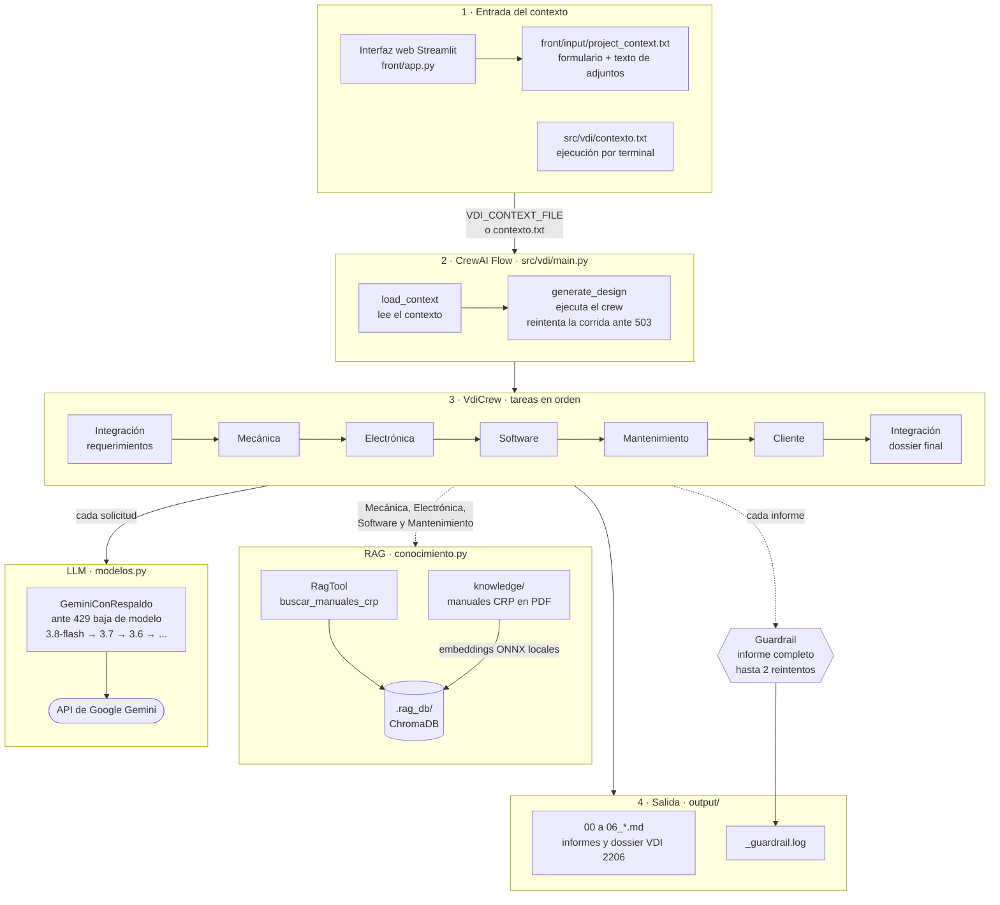

# VDI 2206 — Framework Multi-Agente para Revisión de Diseño Mecatrónico

Framework basado en **CrewAI Flows** y modelos de lenguaje **Google Gemini** para automatizar el ciclo de diseño conceptual mecatrónico bajo la norma **VDI 2206**. El sistema ejecuta una tripulación de 6 agentes especializados por disciplina —Integración, Mecánica, Electrónica, Software, Mantenimiento y Validación del Cliente— para generar reportes individuales por disciplina y un dossier técnico consolidado.

---

## 📑 Tabla de Contenidos

- [Requisitos Previos](#requisitos-previos)
- [Arquitectura del Sistema](#️-arquitectura-del-sistema)
- [Estructura del Proyecto](#️-estructura-del-proyecto)
- [Guía Paso a Paso (Windows)](#-guía-paso-a-paso)
- [Configuración y Comportamiento de la Ejecución](#️-configuración-y-comportamiento-de-la-ejecución)
- [Interfaz Web (Streamlit)](#️-interfaz-web-streamlit)
- [Documentos de Consulta (RAG)](#-documentos-de-consulta-rag)
- [Búsqueda Web por MCP (Tavily)](#-búsqueda-web-por-mcp-tavily)
- [Archivos de Salida](#-archivos-de-salida-output)
- [Visualización de Entregables](#-visualización-de-entregables-markdown-en-vs-code)

---

## Requisitos Previos

- Sistema operativo Windows
- Cuenta de Google (para la API key de Gemini)
- Conexión a internet para descargar dependencias
- Python 3.12 (lo instala `uv` en el [paso 3](#3-instalar-uv-y-python-312); no hace falta instalarlo por separado)

> ⚠️ **Cuota de Gemini:** el plan gratuito permite pocas solicitudes por día y por modelo (del orden de 20) y 5 por minuto. Una corrida completa hace al menos 7 solicitudes (una por tarea), más las consultas al RAG y los reintentos. Cuando un modelo agota su cuota, la corrida sigue con el siguiente (ver [Cambio de modelo ante cuota agotada](#cambio-de-modelo-ante-cuota-agotada-429)). Para probar la interfaz sin gastar cuota usa el modo **Simulación** de la [Interfaz Web](#️-interfaz-web-streamlit).

---

## 🏗️ Arquitectura del Sistema



- **Entrada:** el contexto del proyecto llega desde la interfaz web (que también agrega el texto de los documentos adjuntos) o desde `src/vdi/contexto.txt` al ejecutar por terminal.
- **Flow:** `main.py` carga el contexto y ejecuta el crew. Si Gemini está saturado (503), repite la corrida completa con esperas crecientes.
- **Crew:** 7 tareas en orden; cada agente recibe los informes anteriores. Un guardrail revisa que cada informe esté completo.
- **RAG:** los agentes de Mecánica, Electrónica, Software y Mantenimiento consultan los manuales de `knowledge/`. Los embeddings se calculan en local, sin gastar cuota de Gemini.
- **LLM:** todas las solicitudes pasan por `GeminiConRespaldo`, que cambia de modelo cuando uno agota su cuota diaria.
- **Salida:** los informes quedan en `output/` y la interfaz web los muestra en pestañas.

El servidor MCP de Tavily (`test_mcp.py`) todavía no forma parte del flujo; ver [Búsqueda Web por MCP](#-búsqueda-web-por-mcp-tavily).

---

## 🗂️ Estructura del Proyecto

```text
├── src/vdi/
│   ├── main.py                     # Flow de CrewAI: carga el contexto y ejecuta el crew (con reintentos)
│   ├── contexto.txt                # Contexto del proyecto para ejecuciones desde la terminal
│   └── crews/vdicrew/
│       ├── vdicrew.py              # Agentes, tareas, LLM y guardrail de informes completos
│       ├── conocimiento.py         # RAG de los documentos de knowledge/ (RagTool)
│       ├── modelos.py              # LLM de Gemini con cambio de modelo ante el error 429
│       └── config/
│           ├── agents.yaml         # Rol, objetivo y trasfondo de los 6 agentes
│           └── tasks.yaml          # Las 7 tareas y el archivo de salida de cada una
├── knowledge/                      # Documentos de consulta del RAG (PDF, DOCX, TXT, MD)
├── front/                          # Interfaz web en Streamlit (app.py, simulación y ejemplos)
├── test_mcp.py                     # Prueba de conexión al servidor MCP de Tavily
├── output/                         # Informes generados (no se versiona)
├── .rag_db/                        # Índice vectorial del RAG (no se versiona)
├── AGENTS.md                       # Referencia de CrewAI para asistentes de código (Claude, Cursor...)
├── .python-version                 # Versión de Python del proyecto (3.12)
└── pyproject.toml / uv.lock        # Dependencias del proyecto
```

### Flujo de agentes

Las tareas se ejecutan en orden (`Process.sequential`) y cada una recibe los informes anteriores:

| # | Agente | Tarea | Informe |
|---|---|---|---|
| 1 | Integración (team lead) | Matriz de requerimientos y arquitectura VDI 2206 | `01_requirements_and_system.md` |
| 2 | Mecánica | Subsistema mecánico y BOM | `02_mechanical_subsystem.md` |
| 3 | Electrónica | Hardware de control/potencia y BOM | `03_electronic_subsystem.md` |
| 4 | Software | Arquitectura de software/firmware | `04_software_architecture.md` |
| 5 | Mantenimiento | Evaluación RAMS y diagnóstico | `05_rams_maintenance.md` |
| 6 | Cliente | Dictamen de calidad y aceptación | `06_client_acceptance.md` |
| 7 | Integración (team lead) | Expediente consolidado | `00_vdi2206_consolidated_dossier.md` |

Los agentes de Mecánica, Electrónica, Software y Mantenimiento pueden consultar los manuales de `knowledge/` (ver [Documentos de Consulta](#-documentos-de-consulta-rag)).

---

## 📋 Guía Paso a Paso:

Sigue esta secuencia de pasos para configurar el entorno desde cero en un sistema Windows recién formateado o sin herramientas previas.

### 1. Instalar Software Base

- **Git for Windows:** necesario para clonar el proyecto. Descarga e instala desde la [Guía de Instalación Oficial de Git](https://git-scm.com/download/win).
- **Visual Studio Code:** editor de código recomendado. Descarga e instala desde la [Guía de Instalación Oficial de VS Code](https://code.visualstudio.com/docs/setup/windows).

### 2. Obtener API Key de Google Gemini

1. Accede a [Google AI Studio](https://aistudio.google.com/) e inicia sesión con tu cuenta de Google.
2. Genera una nueva clave en la sección **Get API Key**. Consulta la [Documentación Oficial de Google AI Studio](https://ai.google.dev/gemini-api/docs/api-key) para más detalles sobre cuotas y permisos.

### 3. Instalar `uv` y Python 3.12

**uv** administra las versiones de Python, el entorno virtual y las dependencias del proyecto. No hace falta instalar Python desde python.org ni Anaconda.

1. Abre **PowerShell** en tu equipo.
2. Ejecuta el comando de instalación oficial (consulta la [Guía de Instalación Oficial de uv](https://docs.astral.sh/uv/getting-started/installation/)):

   ```powershell
   powershell -ExecutionPolicy ByPass -c "irm https://astral.sh/uv/install.ps1 | iex"
   ```

3. **Cierra y vuelve a abrir PowerShell** para que el comando `uv` quede registrado en las variables de sistema, y comprueba la instalación:

   ```powershell
   uv --version
   ```

4. Instala Python 3.12, la versión que usa el proyecto (fijada en el archivo `.python-version`):

   ```powershell
   uv python install 3.12
   ```

> El proyecto admite Python 3.10 a 3.13 (`pyproject.toml`). Si ya tienes otra instalación de Python, uv no la modifica: usa la 3.12 solo para este proyecto.

### 4. Clonar el Repositorio y Abrir en VS Code

1. En PowerShell, navega a la carpeta donde guardarás tus proyectos (por ejemplo, el Escritorio):

   ```powershell
   cd ~\Desktop
   ```

2. Clona el repositorio:

   ```powershell
   git clone <URL_DE_TU_REPOSITORIO>
   ```

3. Abre VS Code y, desde el menú **Archivo > Abrir carpeta...** (`File > Open Folder...`), selecciona la carpeta del proyecto clonado (`vdi`).

### 5. Sincronizar el Entorno Local y Crear la API Key

1. Abre la terminal integrada de VS Code (`Ctrl + ~` o menú **Terminal > Nueva Terminal**).
2. Ejecuta el siguiente comando para crear el entorno virtual e instalar CrewAI y todas las librerías necesarias definidas en `pyproject.toml` (más información en la [Guía de Inicio Rápido de CrewAI](https://docs.crewai.com/installation)):

   ```powershell
   uv sync
   ```

   Esto crea la carpeta `.venv/` con Python 3.12 y todas las dependencias. Los comandos `uv run ...` usan ese entorno aunque no esté activado.

3. En la raíz del proyecto (junto al archivo `pyproject.toml`), crea un nuevo archivo llamado `.env`.
4. Agrega tu clave de API de Gemini dentro del archivo `.env`:

   ```env
   GEMINI_API_KEY="tu_api_key_aqui"
   ```

### 6. Definir el Contexto del Proyecto (Caso de Estudio)

Todos los agentes leen el contexto del proyecto desde `src/vdi/contexto.txt`. Edita ese archivo y respeta las secciones:

```text
## TIPO DE SISTEMA
Efector Final (Gripper) para Manipulación de Láminas de Acero

## ALCANCE DEL PROYECTO
Diseño mecatrónico e integración de un efector final (gripper) liviano (< 1.5 kg) ...

## REQUERIMIENTOS PRIMARIOS
- Masa total del gripper <= 1.5 kg ...
- Tiempo de ciclo pick-and-place <= 4.0 s.

## COSTO OBJETIVO
Costo objetivo de fabricación <= 1000 USD.
```

Los modelos de Gemini se configuran con la variable `VDI_LLM_MODELS` en el `.env` (ver [Configuración](#️-configuración-y-comportamiento-de-la-ejecución)).

> Si usas la [Interfaz Web](#️-interfaz-web-streamlit) no necesitas editar este archivo: la interfaz genera el contexto en `front/input/project_context.txt`.

### 7. Ejecutar

En la terminal integrada de VS Code, inicia la ejecución del flujo de agentes:

```powershell
uvx crewai run
```

*(También puedes ejecutarlo con `uv run kickoff`).*

Al terminar, los informes quedan en `output/` (ver [Archivos de Salida](#-archivos-de-salida-output)). Para detener la ejecución presiona **`Ctrl + C`**: se cierra todo el proceso de inmediato, incluidas las solicitudes en curso a Gemini.

> La primera ejecución indexa los documentos de consulta de `knowledge/` (alrededor de 1 minuto). Las siguientes reutilizan el índice. Ver [Documentos de Consulta (RAG)](#-documentos-de-consulta-rag).

---

## ⚙️ Configuración y Comportamiento de la Ejecución

### Variables del `.env`

| Variable | Obligatoria | Uso |
|---|---|---|
| `GEMINI_API_KEY` | Sí | API key de Google Gemini |
| `VDI_LLM_MODELS` | No | Cadena de modelos de Gemini, del mejor al peor, separados por comas (por defecto, la de `modelos.py`) |
| `VDI_CONTEXT_FILE` | No | Ruta de un `.txt` de contexto distinto de `src/vdi/contexto.txt`. La interfaz web la define sola |
| `TAVILY_API_KEY` | No | Solo para la [prueba de MCP](#-búsqueda-web-por-mcp-tavily) |

### Parámetros del LLM y del crew

Definidos en `src/vdi/crews/vdicrew/vdicrew.py`:

- `temperature=0.2` y `max_tokens=32000` (incluye los tokens de razonamiento de Gemini; con valores bajos los informes se cortan).
- `max_rpm=4`: el crew no pasa de 4 solicitudes por minuto, por debajo del límite de 5 del plan gratuito.

### Cambio de modelo ante cuota agotada (429)

El plan gratuito de Gemini tiene una cuota diaria **por modelo**. Cada corrida empieza con el mejor modelo y, si Gemini responde `429` (cuota agotada), repite la **misma solicitud** con el siguiente modelo de la cadena. El crew sigue desde la tarea en que iba, sin repetir las anteriores:

```text
gemini-3.8-flash → gemini-3.7-flash → gemini-3.6-flash → gemini-3.5-flash → gemini-3.5-flash-lite
→ gemini-3-flash-preview → gemini-3.1-flash-lite → gemini-2.5-flash → gemini-2.5-flash-lite
```

- Cada cambio se muestra en el log: `[VDI] Cuota agotada en gemini-3.8-flash (429). Se continua con gemini-3.7-flash.`
- Los modelos agotados se saltan durante el resto de la corrida, en todos los agentes. La siguiente corrida vuelve a empezar por `gemini-3.8-flash`, por si su cuota ya se renovó.
- Si el `429` es por el límite **por minuto** y no por la cuota diaria, se espera lo que indique Gemini (o 60 s) y se reintenta con el mismo modelo, hasta 3 veces.
- Si se agotan todos los modelos, la corrida se detiene con el error `CuotaAgotadaError`.

Para usar otra cadena, defínela en el `.env`. Usa solo nombres con versión, como `gemini-3.7-flash`: con nombres como `gemini-flash-latest`, CrewAI desactiva las herramientas y el razonamiento.

```env
VDI_LLM_MODELS="gemini-3.8-flash,gemini-3.7-flash,gemini-3.6-flash"
```

### Informes completos (guardrail)

Cada tarea debe terminar su informe con la línea `<!-- FIN DEL INFORME -->` (se pide en `tasks.yaml`). Un guardrail revisa que el informe tenga esa marca y que no quede ningún bloque de código o diagrama Mermaid sin cerrar. Si el informe llega cortado, la tarea se repite hasta 2 veces; después se acepta tal cual para no perder la corrida. Cada revisión queda registrada en `output/_guardrail.log` (`COMPLETO`, `REINTENTO` o `ACEPTADO_INCOMPLETO`).

> Cada reintento del guardrail gasta solicitudes adicionales de Gemini.

### Reintentos ante saturación del modelo

Si Gemini responde que está saturado (error 503, `UNAVAILABLE`, `overloaded`) o corta la conexión, `src/vdi/main.py` repite la corrida completa hasta 3 veces, esperando 60, 120 y 240 s entre intentos. Los demás errores (por ejemplo, API key inválida o cuota agotada en todos los modelos) detienen la corrida de inmediato.

### Ver el diagrama del flujo

```powershell
uv run plot
```

Abre en el navegador un diagrama de bloques del flujo (`load_context` → `generate_design`). No llama a Gemini.

### Ejecutar con un contexto en JSON

En lugar de leer `contexto.txt`, el flujo puede recibir el contexto como argumento:

```powershell
uv run run_with_trigger '{\"contexto\": \"## TIPO DE SISTEMA ...\"}'
```

---

## 🖥️ Interfaz Web (Streamlit)

Además de la terminal, el flujo se puede usar desde una interfaz web en `front/`, sin editar `contexto.txt` a mano.

### Ejecutar la interfaz

Desde la raíz del proyecto (Streamlit, pypdf y python-docx se instalan solos desde `front/requirements.txt`):

```powershell
uv run --with-requirements front/requirements.txt streamlit run front/app.py
```

Se abre en el navegador en `http://localhost:8501`.

### Uso

1. **Modo de ejecución** (barra lateral):
   - **Simulación (mock):** no llama a Gemini. Devuelve los informes de ejemplo de `front/ejemplos/salida/`. Úsalo para probar la interfaz sin gastar cuota.
   - **Agentes reales (CrewAI):** ejecuta el flujo completo con Gemini. Requiere el `.env` con `GEMINI_API_KEY` en la raíz.
2. **Contexto del problema:** tipo de sistema y alcance (obligatorios), requerimientos, costo objetivo y contexto adicional.
3. **Documentos de soporte (opcional):** TXT, MD, CSV, PDF o DOCX. Su texto se extrae y se agrega al contexto del proyecto, así que lo leen **todos** los agentes en cada corrida.
4. **🚀 Generar input y ejecutar agentes:** genera `front/input/project_context.txt` y lanza el flujo, mostrando el log en vivo. No recargues la página mientras corre.
5. **Resultados:** cada informe aparece en una pestaña, con botón de descarga.

| Modo | Informes en | Corridas anteriores |
|---|---|---|
| Simulación | `front/output/` | Se reemplazan |
| Agentes reales | `output/` | Se archivan en `output/_anteriores/<fecha>/` |

En `front/ejemplos/entrada/` hay textos y documentos de ejemplo para llenar el formulario.

> **Documentos de soporte vs. documentos de consulta:** los adjuntos de la interfaz son específicos de un proyecto y se copian completos en el contexto de todos los agentes. Los de `knowledge/` son una base de consulta permanente que los agentes buscan por fragmentos con RAG (ver la siguiente sección). Para manuales extensos usa `knowledge/`.

---

## 📚 Documentos de Consulta (RAG)

Los agentes de **Mecánica, Electrónica, Software y Mantenimiento** tienen la herramienta `buscar_manuales_crp`, un `RagTool` de `crewai_tools` que busca en los documentos de la carpeta `knowledge/`. Cada agente decide cuándo consultarla para respaldar sus decisiones con datos técnicos. Integración y Cliente no la usan, para no gastar peticiones extra al LLM.

- **Documentos actuales:** manuales del robot industrial CRP (operación, programación, armario eléctrico G4-CD60, PLC, soldadura y brazo RA09A-07), en inglés. Por eso los agentes escriben las consultas en inglés.
- **Embeddings locales:** se calculan con ONNX en el propio equipo, sin API key y **sin gastar cuota de Gemini**. Solo la consulta del agente pasa por el LLM.
- **Índice:** se guarda en `.rag_db/` (excluida de git) y solo se reconstruye cuando cambian los documentos.

### Cambiar los documentos

1. Agrega, reemplaza o borra archivos en `knowledge/`. Formatos admitidos: **PDF, DOCX, TXT y MD**. RagTool extrae el texto y lo trocea automáticamente.
2. Si cambia el tema de los documentos, actualiza `DESCRIPCION` en `src/vdi/crews/vdicrew/conocimiento.py`: es el texto que lee el agente para decidir cuándo usar la herramienta.
3. Ejecuta el proyecto como siempre. Se detecta el cambio (nombre, tamaño o fecha de los archivos, guardados en `.rag_db/documentos_indexados.json`) y se reindexa todo desde cero.

Para forzar una reindexación, borra la carpeta `.rag_db/`. Para probar la búsqueda sin llamar a Gemini:

```powershell
uv run python -c "from vdi.crews.vdicrew.conocimiento import buscar; print(buscar('emergency stop wiring'))"
```

---

## 🌐 Búsqueda Web por MCP (Tavily)

[Tavily](https://tavily.com/) ofrece un servidor **MCP** (Model Context Protocol) remoto para buscar en la web, por ejemplo datasheets o precios de componentes comerciales. El script `test_mcp.py` verifica la conexión con ese servidor **sin llamar a Gemini**.

> **Estado:** por ahora es solo una prueba de conexión. Los agentes del crew todavía no usan este servidor MCP.

### Configuración

1. Crea una cuenta en [Tavily](https://app.tavily.com/) y copia tu API key. El plan gratuito incluye un cupo mensual de búsquedas.
2. Agrégala al `.env` de la raíz, junto a la de Gemini:

   ```env
   TAVILY_API_KEY="tu_api_key_de_tavily"
   ```

### Probar la conexión

```powershell
uv run python test_mcp.py
```

El script:

1. Carga `TAVILY_API_KEY` del `.env`.
2. Se conecta a `https://mcp.tavily.com/mcp/` por HTTP (streamable HTTP).
3. Lista las herramientas que expone el servidor.
4. Hace una búsqueda de prueba (`vacuum gripper 24V UR5 datasheet`) y muestra los primeros 500 caracteres de la respuesta.

Cada ejecución gasta **una búsqueda** del cupo de Tavily.

---

## 📁 Archivos de Salida (`/output`)

Toda la documentación generada por los agentes se guarda de forma independiente en la carpeta `output/` (excluida del control de versiones mediante `.gitignore`):

| Archivo | Contenido |
|---|---|
| `output/01_requirements_and_system.md` | Matriz de Requerimientos e Integración VDI 2206 |
| `output/02_mechanical_subsystem.md` | Concepto Mecánico/Mecanismos + **BOM Preliminar de Materiales** |
| `output/03_electronic_subsystem.md` | Hardware de Control/Potencia + **BOM Electrónico** |
| `output/04_software_architecture.md` | Arquitectura Conceptual de Software/Firmware **sin código** |
| `output/05_rams_maintenance.md` | Evaluación de Mantenibilidad RAMS y Diagnóstico PHM |
| `output/06_client_acceptance.md` | Dictamen de Calidad y Criterios de Aceptación del Cliente |
| `output/00_vdi2206_consolidated_dossier.md` | **Expediente Final Consolidado VDI 2206** |

---

## 📊 Visualización de Entregables Markdown en VS Code

Para leer y revisar los informes formateados dentro de VS Code:

1. Abre cualquier archivo dentro de la carpeta `output/`.
2. Presiona la combinación de teclas **`Ctrl + K`** y luego **`V`** (o haz clic en el botón de vista previa dividida en la esquina superior derecha).