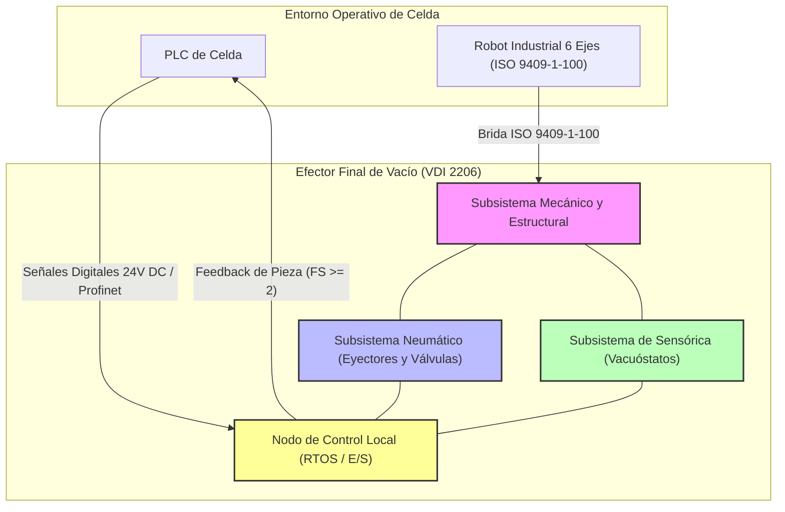

# DOSSIER DE DISEÑO CONCEPTUAL VDI 2206 - EFECTOR FINAL DE VACÍO

**Fecha:** 2026-10-12  
**Autor:** Lead System & Mechatronics Integration Engineer  
**Norma de Referencia:** VDI 2206 (Desarrollo de sistemas mecatrónicos y de IoT)  

---

## 1. RESUMEN DE LA ARQUITECTURA GLOBAL DEL SISTEMA

A continuación se consolida la arquitectura global del efector final de vacío para la manipulación de láminas de acero estampadas, integrando las interfaces físicas, neumáticas, eléctricas y de control, así como la jerarquía de software y el monitoreo de condición RAMS/PHM.

---

## 2. MATRIZ DE REQUERIMIENTOS FUNCIONALES Y CUMPLIMIENTO CONSOLIDADO

| ID | Dominio | Requerimiento Funcional / Restricción | Parámetro Técnico / Valor Objetivo | Resultado Consolidado / Verificación |
|---|---|---|---|---|
| **REQ-MEC-01** | Mecánico | Capacidad de carga nominal | Masa máx. lámina: $8\text{ kg}$ ($1200 \times 900 \times 0.8\text{ mm}$) | **Conforme** (Matriz de 8 ventosas de fuelle) |
| **REQ-MEC-02** | Mecánico | Restricción de masa del efector | Masa total del gripper $\le 6\text{ kg}$ | **Conforme** (Masa total calculada: $3.22\text{ kg}$) |
| **REQ-MEC-03** | Mecánico | Interfaz mecánica con robot | Brida estándar ISO 9409-1-100 | **Conforme** (Placa adaptadora CNC dedicada) |
| **REQ-MEC-04** | Mecánico | Integridad superficial de la lámina | Sin marcas, rayones ni deformaciones visibles | **Conforme** (Ventosas NBR aptas para aceite) |
| **REQ-NEU-01** | Neumático | Suministro neumático disponible | Aire comprimido a $6\text{ bar}$ | **Conforme** (Eyectores SMC optimizados) |
| **REQ-NEU-02** | Neumático | Factor de seguridad de sujeción | $FS \ge 2$ con aceleración de $5\text{ m/s}^2$ | **Conforme** (Validado analógicamente) |
| **REQ-NEU-03** | Neumático | Seguridad ante caída por fallo eléctrico | Retención de pieza ante pérdida de energía | **Conforme** (Válvulas biestables de doble solenoide) |
| **REQ-ELE-01** | Eléctrico | Alimentación eléctrica del sistema | $24\text{ V DC}$ | **Conforme** (Bus dedicado y protegido) |
| **REQ-ELE-02** | Control | Tiempo de ciclo total (Tomar-Depositar) | $T_{\text{ciclo}} \le 12\text{ s}$ | **Conforme** (Evacuación $< 300\text{ ms}$) |
| **REQ-ELE-03** | Sensórica | Detección de presencia de pieza | Sensores de vacío analógicos/digitales | **Conforme** (Vacuóstatos digitales ZSE30AF) |
| **REQ-ECO-01** | Gestión | Costo objetivo de materiales (BOM) | $\le 4500\text{ USD}$ | **Conforme** ($1,955.00\text{ USD}$ total consolidado) |
| **REQ-OPE-01** | Operativo | Disponibilidad y mantenimiento | 2 turnos, 5 días/sem; Mantenimiento $\le 30\text{ min}$ | **Conforme** (Diseño DFMA y MTBF $\ge 15,000\text{ h}$) |

---

## 3. CONSOLIDADO DE LISTA DE MATERIALES (BOM GLOBAL)

La siguiente tabla unifica los costos de materiales de los subsistemas mecánico, neumático, electrónico y de control, demostrando el cumplimiento estricto del presupuesto objetivo.

| Subsistema / Dominio | Componentes Principales | Costo Total Parcial (USD) | Fuente / Proveedor |
|---|---|---|---|
| **Subsistema Mecánico y Estructural** | Placa brida, perfiles 80/20, tornillería inox | $310.00$ | CNC Custom / McMaster-Carr |
| **Subsistema Neumático** | 8 ventosas Piab, 2 eyectores SMC ZK2A, racores | $687.00$ | Piab / SMC |
| **Subsistema Eléctrico y de Control** | 2 vacuóstatos ZSE30AF, válvulas biestables, cables M12, relés | $958.00$ | SMC / Phoenix Contact / Finder |
| **TOTAL GENERAL DEL BOM** | **Presupuesto Consolidado de Materiales** | **$1,955.00** | **Objetivo: <= 4,500 USD (Ahorro del 56%)** |

---

## 4. PLAN DE INTEGRACIÓN Y CIERRE VDI 2206

1. **Fase 01 - Diseño Conceptual y Validación:** Completada con la aprobación de la arquitectura de subsistemas y la verificación analítica de esfuerzos y deflexiones en la lámina de $0.8\text{ mm}$.
2. **Fase 02 - Diseño Detallado:** Consolidación de la lista de materiales (BOM) por debajo del presupuesto objetivo ($1,955.00\text{ USD}$) y diseño modular (DFMA) para cumplir con la ventana de mantenimiento semanal de $30\text{ minutos}$.
3. **Fase 03 - Prototipado y Pruebas Alfa:** Verificación de tiempos de evacuación ($< 300\text{ ms}$), validación del factor de seguridad $FS \ge 2$ a $5\text{ m/s}^2$ y pruebas de resistencia ante corte de energía ($24\text{ V DC}$).
4. **Fase 04 - Integración Beta y Comisionamiento:** Pruebas de ciclo completo en celda robotizada con láminas aceitadas, incorporación de las ECRs de mantenimiento (tornillos imperdibles y manómetro visual) y certificación final de disponibilidad operativa ($A > 99.99\%$).

<!-- FIN DEL INFORME -->