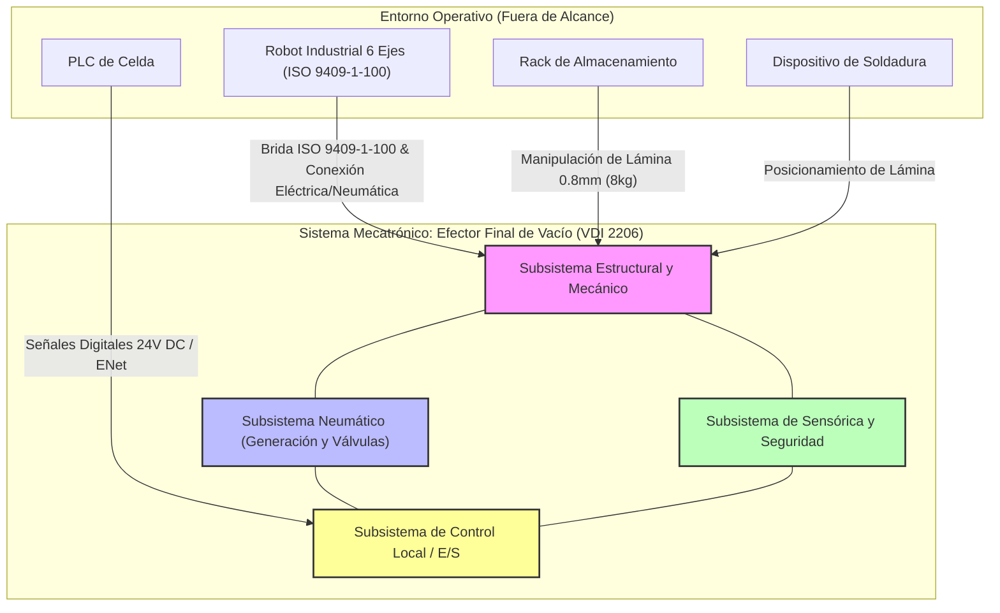

# INFORME DE ARQUITECTURA DE SISTEMA - EFECTOR FINAL DE VACÍO (VDI 2206)

**Fecha:** 2026-10-12  
**Autor:** Lead System & Mechatronics Integration Engineer  
**Norma de Referencia:** VDI 2206 (Desarrollo de sistemas mecatrónicos y de IoT)  

---

## 1. DELIMITACIÓN Y FRONTERAS DEL SISTEMA

El sistema mecatrónico se define bajo el marco de la norma VDI 2206, estableciendo interfaces físicas, neumáticas, eléctricas y de datos bien definidas con su entorno operativo (Robot industrial, PLC de celda, Rack de almacenamiento y Dispositivo de soldadura).

---

## 2. MATRIZ DE REQUERIMIENTOS FUNCIONALES Y RESTRICCIONES

A continuación se traduce el contexto operativo y los requerimientos primarios en parámetros técnicos cuantificables y verificables, alineados con el costo objetivo.

| ID | Subsistema / Dominio | Requerimiento Funcional / Restricción | Parámetro Técnico / Valor Objetivo | Criterio de Verificación |
|---|---|---|---|---|
| **REQ-MEC-01** | Mecánico | Capacidad de carga nominal | Masa máxima de lámina: $8\text{ kg}$ ($1200 \times 900\text{ mm}$, espesor $0.8\text{ mm}$) | Prueba estática de carga máxima |
| **REQ-MEC-02** | Mecánico | Restricción de masa del efector | Masa total del gripper $\le 6\text{ kg}$ | Pesaje en báscula calibrada |
| **REQ-MEC-03** | Mecánico | Interfaz mecánica con robot | Brida estándar ISO 9409-1-100 | Inspección dimensional y acoplamiento físico |
| **REQ-MEC-04** | Mecánico | Integridad superficial de la lámina | Sin marcas, rayones ni deformaciones visibles | Inspección visual post-manipulación bajo luz rasante |
| **REQ-NEU-01** | Neumático | Suministro neumático disponible | Aire comprimido a $6\text{ bar}$ | Medición con manómetro en línea |
| **REQ-NEU-02** | Neumático | Factor de seguridad de sujeción | $FS \ge 2$ con aceleración tangencial/normal de $5\text{ m/s}^2$ | Cálculo analítico y prueba dinámica en robot |
| **REQ-NEU-03** | Neumático | Seguridad ante caída por fallo eléctrico | Retención de pieza ante pérdida de energía (Válvulas biestables / eyectores con bloqueo) | Prueba de corte abrupto de alimentación 24V DC |
| **REQ-ELE-01** | Eléctrico / Control | Alimentación eléctrica del sistema | $24\text{ V DC}$ | Multímetro en terminales de entrada |
| **REQ-ELE-02** | Control / Automatización | Tiempo de ciclo total (Tomar-Depositar) | $T_{\text{ciclo}} \le 12\text{ s}$ | Cronometraje en celda robotizada |
| **REQ-ELE-03** | Sensórica | Detección de presencia de pieza | Sensores de vacío analógicos/digitales integrados por zona | Validación de señal digital hacia PLC |
| **REQ-ECO-01** | Gestión de Proyecto | Costo objetivo de materiales (BOM) | $\le 4500\text{ USD}$ | Consolidado de costos de adquisición |
| **REQ-OPE-01** | Operativo / Mantenimiento | Disponibilidad y entorno de trabajo | 2 turnos de $8\text{ horas}$, $5\text{ días/semana}$, presencia de aceite de estampado | Evaluación de desgaste y limpieza en mantenimiento semanal ($30\text{ min}$) |

---

## 3. ARQUITECTURA DE SUBSISTEMAS E INTERFACES

El diseño mecatrónico se divide en cuatro dominios principales que interactúan entre sí para cumplir con la función global de transferencia de material:

*   **Subsistema Estructural y Mecánico:**
    *   Perfilería de aluminio modular o estructura de chapa de aluminio aligerada para garantizar rigidez torsional y mantener la masa por debajo de los $6\text{ kg}$.
    *   Matriz de ventosas de fuelle (compuesto deNBR o silicona anti-marcas apto para aceites de estampado) distribuidas para evitar pandeo en la lámina delgada ($0.8\text{ mm}$).
*   **Subsistema Neumático:**
    *   Generadores de vacío por efecto Venturi o bombas de vacío compactas alimentadas a $6\text{ bar}$.
    *   Electroválvulas de control rápido (succión / soplado para liberación rápida) con bloqueo mecánico ante pérdida de energía.
*   **Subsistema de Sensórica:**
    *   Vacuóstatos electrónicos con salida digital y/o analógica para confirmación de vacío umbral antes de autorizar el movimiento del robot.
    *   Sensores de posición magnética en cilindros o actuadores neumáticos auxiliares (si aplica).
*   **Subsistema de Control Local:**
    *   Nodo de E/S descentralizado o bloque de bornas conectadas mediante bus de campo o arnés de 24 V DC hacia el PLC de la celda y el controlador del robot.

---

## 4. CONSOLIDACIÓN Y PLAN DE INTEGRACIÓN VDI 2206

1.  **Fase 01 - Diseño Conceptual:** Validación de la disposición de ventosas mediante simulación de centros de gravedad y análisis de deflexión estática de la lámina de acero de $0.8\text{ mm}$.
2.  **Fase 02 - Diseño Detallado:** Selección de componentes comerciales (ventosas, eyectores, racores, perfilería) optimizando el presupuesto para asegurar el cumplimiento estricto del BOM $\le 4500\text{ USD}$.
3.  **Fase 03 - Prototipado y Pruebas Alfa:** Verificación de tiempos de evacuación de vacío ($T < 300\text{ ms}$) y pruebas de arrancamiento para asegurar el factor de seguridad $FS \ge 2$ a $5\text{ m/s}^2$.
4.  **Fase 04 - Integración Beta en Celda:** Pruebas de ciclo completo con láminas aceitadas, validación de la ventana de mantenimiento preventivo de $30\text{ minutos}$ semanales y certificación de seguridad ante fallo de energía.

<!-- FIN DEL INFORME -->