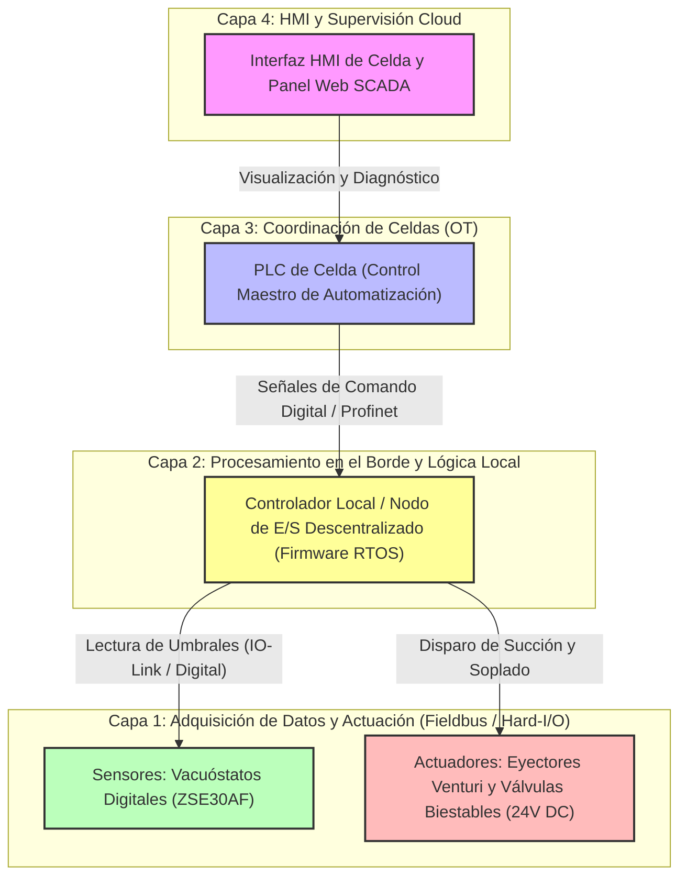
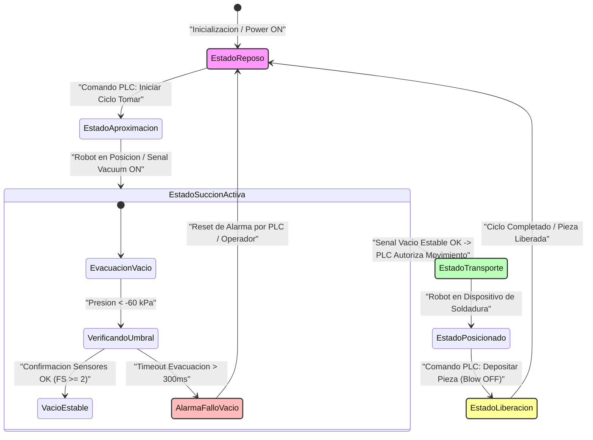

# ARQUITECTURA DE SOFTWARE, FIRMWARE Y LÓGICA DE CONTROL - EFECTOR FINAL DE VACÍO (VDI 2206)

**Fecha:** 2026-10-12  
**Autor:** Lead Software & Firmware Architect  
**Norma de Referencia:** VDI 2206 (Desarrollo de Sistemas Mecatrónicos y de IoT)  

---

## 1. INTRODUCCIÓN Y ALCANCE DE LA ARQUITECTURA DE SOFTWARE

El presente documento define la arquitectura conceptual de software, firmware, lógica de control y capas de comunicación del efector final (gripper) de vacío para la manipulación de láminas de acero estampadas ($1200 \times 900 \times 0.8\text{ mm}$, $8\text{ kg}$). Dado que el sistema opera como un efector inteligente descentralizado conectado a un PLC de celda y a un controlador de robot de 6 ejes mediante señales digitales de $24\text{ V DC}$ y buses de campo estándar, la arquitectura se divide en capas bien delimitadas: procesamiento en el borde (Edge Computing) para la gestión local de sensórica de vacío, lógica de tiempo real para la secuencia neumática, y pasarelas de diagnóstico e interfaz HMI/Cloud para el monitoreo de disponibilidad operativa.

---

## 2. ORGANIZACIÓN MODULAR Y CAPAS DEL SISTEMA

La arquitectura del sistema de software y control se estructura en cuatro capas jerárquicas que garantizan el determinismo temporal, la seguridad operativa y la interoperabilidad con la celda de manufactura:

---

## 3. MÁQUINA DE ESTADOS FINITOS (FSM) DEL EFECTOR FINAL

La secuencia operativa para la manipulación segura de las láminas de acero se rige por una Máquina de Estados Finitos (FSM) implementada en el firmware del nodo de control local. Esta máquina gestiona los tiempos de evacuación, la verificación de vacío umbral para asegurar el factor de seguridad ($FS \ge 2$), y la liberación rápida por soplado.

### Tabla de Transición de Estados de la FSM

| Estado Actual | Condición de Entrada / Evento | Acciones de Control Asociadas | Estado Siguiente |
|---|---|---|---|
| **EstadoReposo** | Encendido del sistema o Reset general | Desenergizar eyectores, apagar válvulas de soplado | **EstadoReposo** |
| **EstadoReposo** | Comando externo del PLC (`CMD_START_GRAB`) | Habilitar alimentación a electroválvulas de succión | **EstadoAproximacion** |
| **EstadoAproximacion** | Robot confirma posición de contacto con lámina | Activar eyectores Venturi de vacío principal | **EstadoSuccionActiva** |
| **EstadoSuccionActiva** | Lectura de vacuóstatos $\le -60\text{ kPa}$ | Validar factor de seguridad $FS \ge 2$, enviar `VAC_OK` al PLC | **EstadoTransporte** |
| **EstadoSuccionActiva** | Tiempo de evacuación $> 300\text{ ms}$ sin alcanzar umbral | Activar bandera de error de succión, detener ciclo | **AlarmaFalloVacio** |
| **EstadoTransporte** | Robot completa trayectoria hacia soldadura | Mantener estado de válvulas biestables (ahorro energético) | **EstadoPosicionado** |
| **EstadoPosicionado** | Comando del PLC (`CMD_RELEASE_PART`) | Desactivar succión, activar pulso breve de soplado (Blow-off) | **EstadoLiberacion** |
| **EstadoLiberacion** | Tiempo de soplado cumplido ($100\text{ ms}$) | Confirmar separación de la lámina de acero | **EstadoReposo** |
| **AlarmaFalloVacio** | Señal de rearme de fallos del PLC (`RESET_ERR`) | Purgar neumática, retornar a posición inicial | **EstadoReposo** |

---

## 4. STACK DE TECNOLOGÍAS Y HERRAMIENTAS DE SOFTWARE

Para satisfacer los requerimientos de tiempo de ciclo ($\le 12\text{ s}$), robustez industrial y mantenimiento preventivo, se propone el siguiente stack tecnológico de desarrollo:

*   **Sistema Operativo de Tiempo Real (RTOS) / Firmware:**
    *   **Plataforma:** FreeRTOS o micro-ROS ejecutándose en microcontroladores de 32 bits basados en arquitectura ARM Cortex-M4/M7 (ej. STM32F4/F7 o equivalente industrial).
    *   **Justificación:** Garantiza la ejecución determinista de las tareas de adquisición de presiones analógicas/digitales y el control de los solenoides con latencias inferiores a $5\text{ ms}$.
*   **Protocolos de Comunicación OT:**
    *   **Capa Física / Enlace:** E/S Digitales estándar de $24\text{ V DC}$ para control de alta velocidad y buses de campo industriales basados en Ethernet (Profinet o EtherCAT) para el intercambio de diagnósticos avanzados con el PLC de celda.
*   **Herramientas de Desarrollo y Modelado:**
    *   **Entorno de Firmware:** STM32CubeIDE / Keil MDK con soporte para depuración SWD (Serial Wire Debug).
    *   **Modelado de Lógica:** Entornos basados en bloques de funciones IEC 61131-3 (Structured Text) para la sincronización con el PLC principal de la celda de carrocería.
    *   **Control de Versiones y CI/CD:** Git / GitLab para la gestión del código fuente de firmware y validación automatizada de scripts de configuración.

---

## 5. CONCLUSIONES DE LA ARQUITECTURA DE SOFTWARE

1.  **Determinismo y Respuesta:** La separación de tareas mediante RTOS en el nodo de borde asegura que la adquisición de vacío y la respuesta ante fallos críticos operen en tiempo real estricto, cumpliendo con la meta de tiempo de ciclo de $\le 12\text{ s}$.
2.  **Seguridad Fail-Safe:** La integración de la máquina de estados con válvulas biestables garantiza que el software y el hardware actúen en conjunto para retener la lámina de acero ante cualquier interrupción imprevista de energía.
3.  **Mantenibilidad:** La modularidad propuesta permite realizar diagnósticos rápidos durante la ventana de mantenimiento preventivo semanal de $30\text{ minutos}$, facilitando la identificación de desgaste en ventosas o anomalías neumáticas.

<!-- FIN DEL INFORME -->