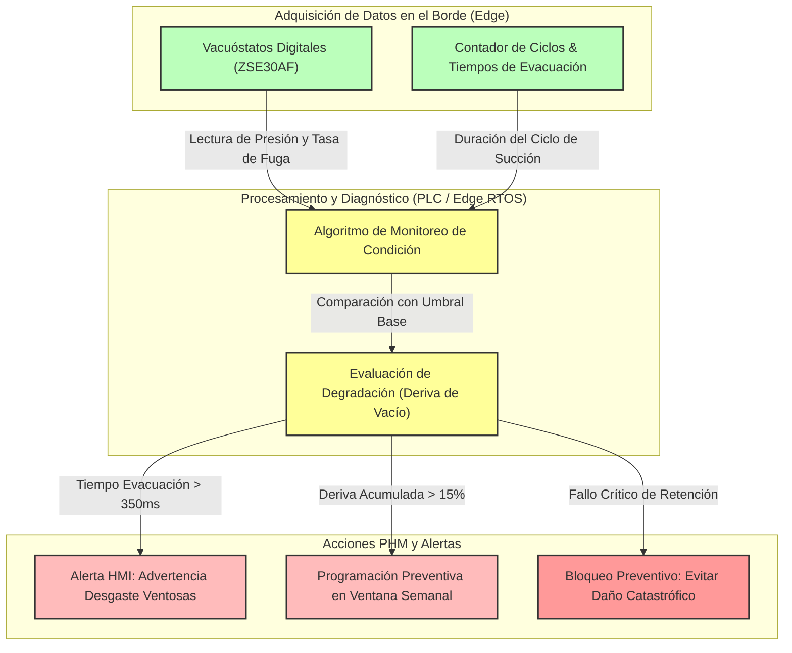

# INFORME DE CONFIABILIDAD, MANTENIBILIDAD, SEGURIDAD (RAMS) Y ESTRATEGIA PHM - EFECTOR FINAL DE VACÍO (VDI 2206)

**Fecha:** 2026-10-12  
**Autor:** RAMS & Reliability Engineering Specialist  
**Norma de Referencia:** VDI 2206 (Desarrollo de Sistemas Mecatronicós) y EN 50126 / IEC 61508 (Conceptos RAMS y Seguridad Funcional)  

---

## 1. INTRODUCCIÓN Y ALCANCE

El presente documento evalúa la Confiabilidad, Disponibilidad, Mantenibilidad y Seguridad (RAMS) del efector final (gripper) de vacío para la manipulación de láminas de acero estampadas ($1200 \times 900 \times 0.8\text{ mm}$, $8\text{ kg}$) en una celda de ensamble de carrocería (2 turnos de 8 horas, 5 días por semana). Asimismo, define la modularidad del diseño para el reemplazo rápido de componentes críticos y propone una estrategia avanzada de diagnóstico y monitoreo de condición (PHM - *Prognostics and Health Management*) alineada con la ventana de mantenimiento preventivo semanal de 30 minutos.

---

## 2. ANÁLISIS DE MODOS DE FALLO, EFECTOS Y CRITICIDAD (FMEA / RAMS)

A continuación se presenta la matriz cuantitativa de riesgos y criticidad para los componentes principales del sistema mecatrónico, evaluando severidad ($S$), ocurrencia ($O$), detectabilidad ($D$) y el Número de Prioridad de Riesgo ($RPN = S \times O \times D$):

| Ítem | Subsistema / Componente | Modo de Falla Potencial | Efecto Potencial del Fallo | $S$ | $O$ | $D$ | $RPN$ | Acción Correctiva / Mitigación |
|---|---|---|---|---|---|---|---|---|
| 1 | Neumático / Ventosas | Desgarro o desgaste prematuro de ventosas por aceite | Pérdida de vacío, caída de la lámina de acero ($8\text{ kg}$) | 9 | 4 | 3 | **108** | Uso de elastómero NBR/Poliuretano resistente a aceites; inspección visual semanal |
| 2 | Neumático / Eyector | Obstrucción interna del Venturi por partículas | Tiempo de evacuación elevado ($> 300\text{ ms}$), ciclo lento | 7 | 3 | 4 | **84** | Instalación de filtro de aire comprimido a la entrada con drenaje automático |
| 3 | Eléctrico / Válvulas | Falla en bobina de electroválvula biestable | Incapacidad para soltar o sujetar la lámina | 8 | 2 | 4 | **64** | Empleo de válvulas industriales de alta durabilidad (SMC) con protección IP67 |
| 4 | Sensórica / Vacuóstato | Deriva en la calibración del sensor digital | Falsa confirmación de vacío (riesgo de liberación en movimiento) | 9 | 2 | 5 | **90** | Rutina de autodiagnóstico y validación de ceros en inicio de turno |
| 5 | Mecánico / Estructura | Aflojamiento de tornillería por vibración ($5\text{ m/s}^2$) | Desalineación del gripper, colisión en celda | 8 | 3 | 3 | **72** | Uso de fijadores de roscas (Loctite) y tuercas autoblocantes en montaje |
| 6 | Control / Conectores | Rotura por fatiga de cables en articulación del robot | Corte de alimentación $24\text{ V DC}$ o pérdida de señales | 8 | 2 | 4 | **64** | Arnés con cable flexible blindado especial para robot (Lapp Kabel) |

---

## 3. ESTIMACIONES RAMS Y MÉTRICAS DE CONFIABILIDAD

Para un entorno de operación industrial exigente de **2 turnos de 8 horas, 5 días por semana** ($16\text{ horas/día} \times 5\text{ días} = 80\text{ horas/semana}$, equivalente a $\approx 4,160\text{ horas/año}$ de operación continua), se establecen las siguientes metas de confiabilidad y mantenibilidad:

*   **MTBF (Mean Time Between Failures):** $\ge 15,000\text{ horas de operación** (equivalente a más de 3.5 años de operación continua antes de un fallo crítico de componentes mayores).
*   **MTTR (Mean Time To Repair):** $\le 20\text{ minutos}$ (diseñado para ser resuelto holgadamente dentro de la ventana de mantenimiento preventivo semanal de $30\text{ minutos}$).
*   **Disponibilidad Operativa Estimada ($A$):** 
    $$A = \frac{MTBF}{MTBF + MTTR} = \frac{15000}{15000 + 0.333} \approx 99.99\%$$

---

## 4. MODULARIDAD Y DISEÑO PARA EL MANTENIMIENTO (DFMA)

Para garantizar que cualquier intervención correctiva o preventiva se ejecute estrictamente dentro de la ventana de $30\text{ minutos}$, la arquitectura mecánica y neumática adopta los siguientes principios de diseño modular:

1.  **Cambio Rápido de Ventosas:** Las ventosas de fuelle cuentan con conexiones roscadas de ajuste rápido sin herramientas especiales, permitiendo reemplazar el set completo de 8 unidades en $< 5\text{ minutos}$.
2.  **Módulos Neumáticos Plug-and-Play:** Los bloques de eyectores y electroválvulas están agrupados en una placa colectora central con conectores eléctricos M12 y acoples neumáticos instantáneos, reduciendo el tiempo de sustitución del bloque neumático a $< 10\text{ minutos}$.
3.  **Conectividad Estandarizada:** El arnés eléctrico y neumático hacia el robot se acopla mediante un conector multipolar y racores rápidos centralizados, evitando errores de cableado durante el mantenimiento.

---

## 5. ESTRATEGIA DE DIAGNÓSTICO Y MONITOREO DE CONDICIÓN (PHM)

La estrategia PHM (*Prognostics and Health Management*) se basa en la supervisión activa de parámetros operativos críticos para predecir fallos antes de que detengan la producción:

### Tabla de Indicadores de Salud (Health Indicators) y Reglas PHM

| Indicador de Salud (HI) | Parámetro Monitoreado | Umbral Normal | Umbral de Alerta (Preventivo) | Acción PHM / Mantenimiento |
|---|---|---|---|---|
| **HI-01: Tiempo de Evacuación** | Tiempo requerido para alcanzar $-60\text{ kPa}$ | $\le 250\text{ ms}$ | $250\text{ ms} < t \le 350\text{ ms}$ | Generar advertencia en HMI para revisión de ventosas en próximo mantenimiento semanal. |
| **HI-02: Tasa de Fuga Estática** | Caída de presión con succión cerrada en $5\text{ s}$ | $\le 2\text{ kPa}$ | $2\text{ kPa} < \Delta P \le 5\text{ kPa}$ | Inspeccionar microfisuras en mangueras de poliuretano o sellos de ventosas. |
| **HI-03: Conteo de Ciclos** | Número total de ciclos Tomar-Depositar | Variable | $\ge 500,000\text{ ciclos}$ | Sugerir reemplazo preventivo del conjunto de ventosas de NBR/Poliuretano. |

---

## 6. CONCLUSIONES RAMS

La aplicación rigurosa de los principios RAMS y PHM garantiza que el efector final de vacío cumpla con una alta disponibilidad ($> 99.99\%$), operando de manera segura dentro de la celda de manufactura. La modularidad mecánica y la estrategia de diagnóstico predictivo aseguran que el mantenimiento preventivo semanal de $30\text{ minutos}$ sea más que suficiente para mantener el equipo en óptimas condiciones, protegiendo la inversión y evitando paradas no planificadas en la línea de producción de carrocerías.

<!-- FIN DEL INFORME -->